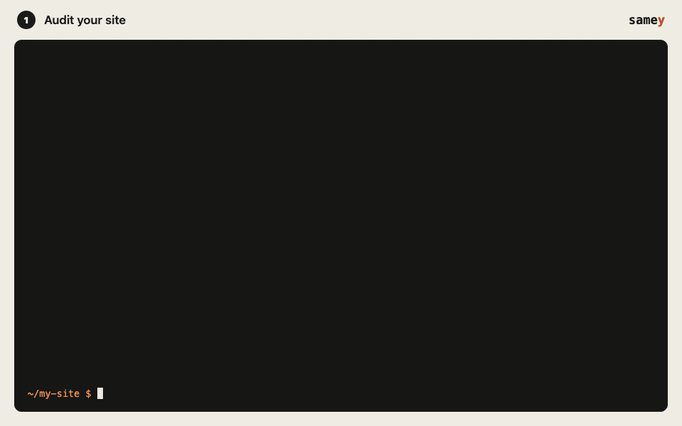
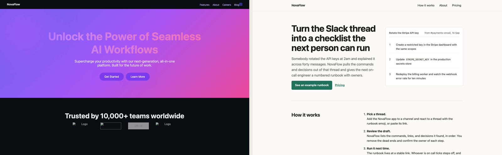

# samey

**Is your AI-built site samey?** samey audits a website built with Claude Code, Cursor, Codex or any other coding agent, shows you what makes it look like every other one, and writes a prompt your agent can use to fix it.

```bash
npx samey-cli audit .
```

Or install it once with `npm i -g samey-cli` and run `samey audit .`.



> **Early release.** The rules work and are tested, but the scoring weights have not been calibrated against human judgment yet. If samey flags something that looks fine to you, or misses something obvious, please [open an issue](https://github.com/azkaiftikhar01/samey/issues) with the URL or a screenshot. That feedback is exactly what will make it accurate.

## What it catches

- **Stock visuals:** the blue-violet-pink gradient, gradient headline text, glows and blurred blobs, emoji used as icons, everything centered.
- **Sameness:** the same three-card grid in every section, the hero-logos-features-testimonials-pricing-FAQ sequence, different pages built from one skeleton.
- **Template copy:** "Unlock the power of seamless...", lorem ipsum, Jane Doe at Acme, unsourced "Trusted by 10,000+ teams".
- **Things that are simply broken:** links to `#`, buttons that do nothing, broken links and images, console errors, pages that scroll sideways on a phone.
- **Accessibility:** the full [axe-core](https://github.com/dequelabs/axe-core) rule set (WCAG 2.0 to 2.2 A and AA plus best practices): colour contrast, missing names and labels, ARIA errors, landmarks, touch target size.
- **Performance:** page weight, JavaScript size, oversized and old-format images, a lazy-loaded main image, layout shift, main-thread blocking, render-blocking scripts, DOM size, compression, caching.
- **SEO:** missing or duplicate titles and descriptions, accidental noindex, canonical problems, missing social previews, broken structured data, no viewport tag, robots.txt and sitemap.
- **Best practices:** HTTPS and mixed content, quirks mode, stretched images, outdated jQuery or Lodash.

Every finding has evidence you can check: the page and viewport, the CSS selector, a screenshot crop with the element outlined, and the source file and line when samey can trace it. Measured defects are kept separate from design observations, which are heuristics that need your judgment. Popular conventions are not penalized on their own.

samey runs entirely on your machine: no account, no API key, no cloud. It measures what is on the page; it does not try to guess who or what wrote it.

## Before and after



| | Slop score | Findings |
| --- | ---: | ---: |
| [Before](examples/novaflow/before) | 57.3 | 33 |
| [After](examples/novaflow/after) | 0 | 0 |

The before site is a deliberately generic landing page. samey produced [this fix prompt](examples/novaflow/fix-prompt.md) for it, and the after site is that site rewritten from the prompt by a coding agent: one deliberate accent colour instead of the gradient, a product preview and a worked example instead of three-card grids, a pricing table, real links, and the invented testimonials and user counts removed rather than reworded. Run both yourself:

```bash
npx samey-cli audit examples/novaflow/before
npx samey-cli audit examples/novaflow/after
```

A score of 0 means samey found nothing to flag, not that a site is perfect. It is a small demo site; real sites will rarely reach zero.

## How it compares

Lighthouse and [Unlighthouse](https://unlighthouse.dev) are excellent for performance and SEO, and samey does not try to replace their timing lab. It checks what they do not, in one local run:

| | samey | Unlighthouse |
| --- | --- | --- |
| One command, whole site | Yes (pages audited in parallel) | Yes |
| Generic "AI look" and cross-page sameness | Yes | No |
| Buttons that do nothing, links to `#`, safe click testing | Yes | Partly |
| Accessibility | axe-core, same engine as Lighthouse | axe-core |
| Performance | Page weight, JS, images, layout shift, blocking time, caching | Full Lighthouse, including load timings |
| SEO and best practices | Yes | Yes |
| Evidence with screenshot crops and `file:line` | Yes | Screenshots |
| Ready-made fix prompt for your coding agent | Yes | No |
| Network sandbox for untrusted URLs | Yes | No |
| Maturity | New | Established |

samey does not report load-time metrics (LCP, FCP, Speed Index). Every request goes through its network guard, which would make those numbers wrong, so it reports only what it can measure accurately. Use Lighthouse alongside it if you need lab timings.

## Quick start

```bash
npx samey-cli setup                    # once: downloads the Chromium build samey uses (about 150 MB)

npx samey-cli audit .                  # a static build (out/, dist/, build/) or plain HTML
npx samey-cli audit . --serve "npm run dev" --port 3000   # samey starts your dev server, audits, stops it
npx samey-cli audit --url https://your-site.com           # a deployed site
npx samey-cli audit . --url http://localhost:3000 --dev   # a dev server you already started
```

Each run writes three files to `.samey/` (add it to your `.gitignore`):

- `report.html`: the full report, self-contained, open it in any browser
- `fix-prompt.md`: a ready-to-paste prompt for your coding agent
- `report.json`: everything, for scripts and agents

## Fix it with your coding agent

```bash
npx samey-cli prompt | pbcopy          # macOS; or open .samey/fix-prompt.md
```

Paste it into Claude Code, Cursor or Codex. The prompt lists measured defects first, then design observations to weigh, each with the page, selector, file and line, and the fix. It tells the agent to ask you for anything only you can provide, like real testimonials or a brand colour, instead of inventing it. Then run `npx samey-cli audit` again to confirm.

Prefer to pick? Tick findings in the HTML report and use "Copy fix prompt", or run `npx samey-cli prompt --only-defects` to skip the design observations.

## Commands

```
samey audit [path] [options]   audit a project, a URL, or both (npx samey-cli audit ...)
samey prompt [path]            print the fix prompt from the last audit
samey setup                    install the browser samey uses
samey rules                    list every rule
```

| Option | Default | Description |
| --- | --- | --- |
| `-u, --url <url>` | | Audit a running site. Overrides any local server. |
| `--dev` | | Development mode: lets `--url` point at localhost or a private network address. |
| `--serve [command]` | | Start the dev server with this command (`npm run dev` if omitted). This runs project code, so it only happens when you pass the flag. |
| `--port <port>` | 4173 | Port the dev server listens on. `PORT` is set in its environment. |
| `--max-routes <n>` | 20 | Maximum pages to render. Skipped pages are listed in the report. |
| `--concurrency <n>` | 3 | Pages audited at the same time. |
| `--timeout <seconds>` | 30 | Navigation timeout per page. |
| `--route <path...>` | | Extra routes to audit. |
| `--format <html\|json\|both>` | both | Which reports to write. `--report` is an alias. |
| `-o, --out <dir>` | `<path>/.samey` | Output directory. |
| `--static-only` | | Only scan source files; do not launch a browser. |
| `--no-screenshots` | | Skip screenshots. |
| `--no-interact` | | Do not click any buttons. |
| `--ignore-robots` | | Crawl pages disallowed by robots.txt. Only for sites you own. |
| `--ignore <rules...>` | | Rule ids to skip (see `samey rules`). |
| `--fail-above <score>` | | Exit with code 1 if the slop score is above this. For CI. |
| `--model <name>` | | Local Ollama vision model for an advisory critique. |
| `--model-endpoint <url>` | `http://127.0.0.1:11434` | Must be a loopback address. |
| `--no-ai` | | Never use a model, even if one is configured. |
| `--json` | | Print the JSON report to stdout. |
| `-q, --quiet` | | Only print the final summary. |

Exit codes: `0` success, `1` score above `--fail-above`, `2` the audit could not run (bad arguments, a blocked or unreachable URL, no page could be rendered, dev server failed to start).

### Config file

`samey.config.json` in the project root sets defaults. Command-line flags win.

```json
{
  "maxRoutes": 15,
  "routes": ["/pricing", "/docs"],
  "ignoreRules": ["centered-everything"],
  "failAbove": 30,
  "serve": "pnpm dev",
  "port": 5173
}
```

`serve` in the config file is only used when you also pass `--serve` on the command line, so cloning an untrusted repository and running `samey audit .` never executes its code.

## How the target is chosen

1. `--url` if given. Public addresses only, unless you pass `--dev`.
2. Otherwise, with `--serve`, the dev server samey starts.
3. Otherwise, a static build in the project (`out/`, `dist/`, `build/`, `_site/`), or the project root if it is plain HTML. samey serves it read-only on 127.0.0.1.
4. Otherwise only static analysis runs, and the report says so. Categories that need a rendered page show n/a rather than a perfect score.

Routes are discovered from links, `sitemap.xml`, `--route`, and route files in the project (Next.js `app/` and `pages/`, SvelteKit, Astro, React Router paths). Dynamic routes like `/blog/[slug]` are skipped.

## What it checks

Run `npx samey-cli rules` for the full list. In summary:

**Visual genericness**: blue-violet-pink gradients (including gradient text), decorative glows, blur blobs and glass panels, one card composition reused across sections, consecutive sections with identical layout, different pages built from the same skeleton, the stock hero-logos-features-testimonials-pricing-FAQ-CTA sequence, centered everything, emoji used as icons.

**Copy and credibility**: stock marketing phrases ("unlock the power", "seamless", "next-generation"), placeholder content (lorem ipsum, Jane Doe, Acme, example.com, placeholder image services), repeated paragraphs, unsourced user counts and ratings, testimonials with only a name and title.

**Functionality**: pages that fail to load, broken internal links, console errors, failed requests, links to `#`, buttons that do nothing or throw when clicked, broken images, horizontal scrolling.

**Accessibility (axe-core)**: about 100 checks from WCAG 2.0 to 2.2 A and AA and axe's best practices, including colour contrast, names for buttons and links, form labels, alt text, ARIA validity, heading order, landmarks, and touch target size on mobile. samey adds text under 12px on mobile and vague link text. If axe cannot run on a page, samey's own simpler checks cover it and the report says so.

**Performance**: pages over 3 MB, more than 1 MB of JavaScript, images far larger than displayed or large JPEG/PNG that should be WebP or AVIF, a lazy-loaded main image, layout shift (CLS) over 0.1, more than 300 ms of main-thread blocking, synchronous scripts in `<head>`, DOMs over 1,500 elements, and on deployed sites uncompressed text files and static files cached for less than a day.

**SEO**: missing, duplicate, or badly sized titles and descriptions, noindex on public pages, conflicting or cross-domain canonical links, missing Open Graph previews, invalid JSON-LD, no viewport tag, `<a>` without href, and on deployed sites a robots.txt that blocks everything or a missing sitemap.

**Best practices**: plain HTTP and mixed content, quirks mode, no declared charset, stretched or squashed images, jQuery before 3.5, Lodash before 4.17.21, AngularJS, Moment.js, and no favicon.

**Design consistency**: too many text-size steps, radii, shadows, or font families; many unsystematic spacing values; hard-coded values bypassing tokens; markup copy-pasted instead of extracted into components.

Static checks on the source tree mirror several rendered checks. When both fire, the source lines are attached to the rendered finding as evidence instead of being reported twice.

### Safe click testing

On each page, samey clicks up to six visible buttons to see whether anything happens. It never clicks links (those are checked by the crawler), anything inside a form, submit buttons, or anything labelled like delete, buy, pay, checkout, subscribe, log out, send, confirm, and similar. Use `--no-interact` to turn this off.

## Scoring

The score counts detected quality problems. It is not a probability that AI wrote the site.

Each finding adds a penalty `p = s × c × w`:

- `s`, severity: info 0, low 0.25, medium 0.5, high 0.75, critical 1
- `c`, confidence: a number from 0 to 1
- `w`, the rule's weight: 40 by default, lower for rules about conventions (centered layouts, the landing-page sequence, unverified claims), higher for hard failures (a page that does not load: 80)

Within a category the penalties add up to `P`, and the category score is `100 × (1 − e^(−P/100))`, so a pile of minor findings approaches 100 but never passes it. The overall score is the weighted average of the measured categories:

| Category | Weight |
| --- | ---: |
| Visual genericness | 40% |
| Content genericness | 20% |
| Functional defects | 15% |
| Accessibility and usability | 15% |
| Performance | 5% |
| SEO | 3% |
| Best practices | 2% |

Categories that could not be measured (for example functional defects in a static-only run) are shown as "not measured" and left out, with the remaining weights renormalized. Identical evidence on several pages, such as a broken link in a shared footer, counts once. The same set of findings always produces the same score. Weights and penalties are starting hypotheses, versioned in the report (`versions.scoring`), and have not yet been calibrated against human judgments, so there are deliberately no labels like "good" or "bad".

## Network safety

Every request the browser makes is intercepted and performed by samey itself, so the audited page cannot use the browser to reach places it should not:

- Only `http` and `https`. URLs with embedded credentials are refused.
- In normal mode only public addresses are reachable. Loopback, private (including carrier-grade NAT), link-local, multicast, documentation, and other reserved ranges are blocked, including IPv4-mapped, NAT64, and 6to4 IPv6 forms and numeric tricks like `http://2130706433/`.
- Hostnames are resolved before connecting, every returned address must be allowed, and the connection is pinned to the checked address, which defeats DNS rebinding.
- Every redirect hop is checked again. Redirect loops and chains longer than 5 hops are stopped.
- Responses are capped at 20 MB each and 250 MB per crawl, with 3,000 requests at most.
- Service workers, downloads, and pop-up windows are blocked. WebSockets are blocked in normal mode. Anything Chromium tries to send outside the interception (preconnects, WebRTC) goes to a closed local port.
- Cloud metadata addresses (169.254.169.254 and others) are never reachable, even with `--dev`.
- With `--dev`, loopback and private addresses are allowed so you can audit a local server. When samey starts the server itself (static build or `--serve`), only loopback is allowed.
- Crawling stays on the starting origin. Pages that redirect to another site are skipped.

Blocked requests are listed in the report's coverage section. Text on the audited page is treated as content, never as instructions.

## Optional local model

```bash
ollama pull qwen2.5vl:7b
samey audit . --model qwen2.5vl:7b
```

samey sends up to three desktop screenshots to the model and asks for specific visual observations. Only loopback endpoints are accepted, so screenshots never leave your machine. Model observations are marked advisory, given confidence 0.3, and never change the score. No model has been benchmarked with samey yet; the model name is recorded in the report. If no model is configured or the server is not running, the audit runs normally and the report notes it.

## For coding agents

`report.json` is designed to be read by agents directly. See [AGENTS.md](AGENTS.md) for its shape and a suggested fixing order.

## Limits

- Twenty routes and two viewports by default (raise with `--max-routes`). Large sites are sampled, not exhausted.
- No load-time metrics (see How it compares). Performance checks run on the desktop render; mobile CPU is slower than what samey measures.
- Heuristics are tuned to avoid false positives on plain, well-built pages, but they are heuristics. Low-confidence findings are worth a look, not an automatic fix.
- Single-page apps that render routes without real URLs only get their first screen audited.
- samey never modifies your source files.

## Development

```bash
npm install
npx playwright install chromium
npm test            # unit, security, and end-to-end tests
npm run typecheck
npm run dev -- audit fixtures/sloppy-site   # run from source
```

`fixtures/sloppy-site` is a deliberately generic multi-page site, `fixtures/clean-site` is a plain site that should produce no genericness findings, and `fixtures/react-app` is a source tree for static analysis. See [PLAN.md](PLAN.md) for status and next steps.

## License

MIT
